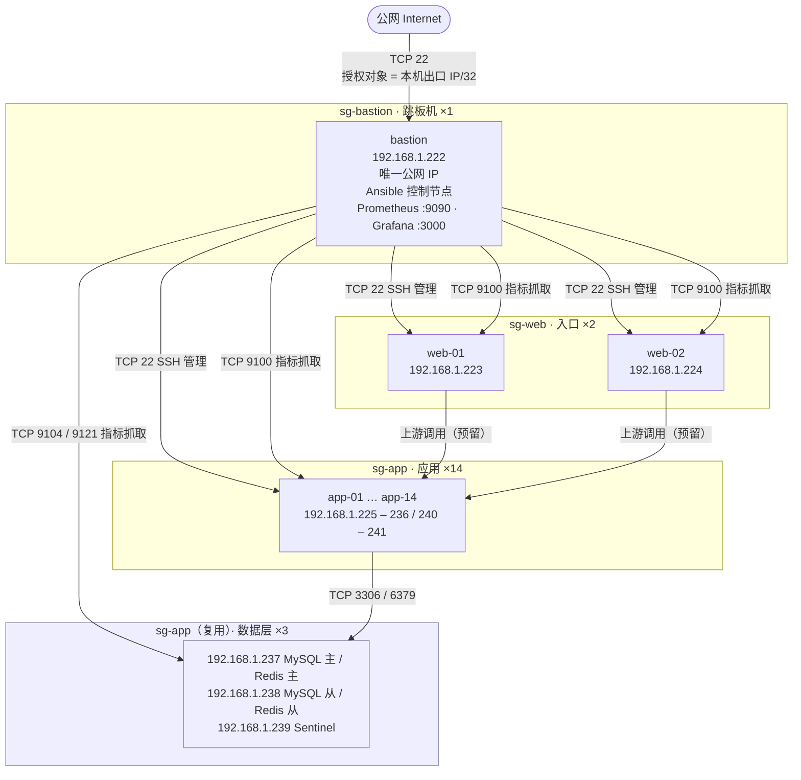

# ops-lab

自建阿里云 ECS 分层环境的运维实践：从开通 20 台按量付费实例开始，到 Ansible 批量配置、SSH 加固、安全组按层收敛、监控告警、故障演练与成本收尾的完整闭环。

所有记录均来自实际执行，包含真实发生的事故与根因分析。

---

## 环境规模

| 角色 | 台数 | 内网地址 | 安全组 | 说明 |
|---|---|---|---|---|
| 跳板机 | 1 | `192.168.1.222` | `sg-bastion` | 唯一公网 IP；Ansible 控制节点；Prometheus + Alertmanager + Grafana |
| 入口 | 2 | `192.168.1.223`–`224` | `sg-web` | Nginx 入口层 |
| 应用 | 14 | `192.168.1.225`–`236`、`240`–`241` | `sg-app` | 业务节点 |
| 数据 | 3 | `192.168.1.237`–`239` | `sg-app`（复用） | MySQL 主从 `.237/.238`、Redis 主从 + 3 哨兵 |
| **合计** | **20** | | 3 个在用安全组 | |

> **数据层没有新建实例，而是复用了应用层的 3 台。** 原因很实际：券余额有限，20 台按量实例每天 30–50 元。
> 代价必须写清楚：这几台仍挂在 `sg-app` 下，**没有做到"数据层独立安全组"这个网络隔离目标**。
> 真正的做法应该是新建 `sg-db`、实例只绑 `sg-db`、3306/6379 只对 `sg-app` 开放，
> 这样应用层被拿下也不能横向直连数据库。README 里把它列为已知偏差，而不是当作已完成。

规格：2 vCPU / 1.8 GiB / 40 GiB 系统盘，Alibaba Cloud Linux 3，按量付费。

---

## 架构



**只有跳板机持有公网 IP。** 入口层与应用层全部在 VPC 内网，公网流量必须经跳板机，或通过安全组授权的内网路径进入。

---

## 关键设计

### 1. 安全组按层收敛，授权对象是「安全组」而非 IP 段

4 个安全组按层划分，每层只信任上游的身份：

| 安全组 | 入方向放行 | 授权对象 |
|---|---|---|
| `sg-bastion` | TCP 22 | 本机出口 IP `/32` |
| `sg-web` | TCP 22、80、443 | `sg-bastion` |
| `sg-app` | TCP 22、9100 | `sg-bastion` |
| `sg-db` | TCP 22、3306、6379、9100、9104、9121 | `sg-app`、`sg-bastion` |

**为什么用安全组而不是 IP 段**：扩容 15 台新机器时，只要绑定到 `sg-app`，9100 那条规则自动覆盖，**控制台零改动**。如果当时填的是 `192.168.1.222/32`，就要再点 15 次，且以后 Prometheus 换机器还得改。

代价是跨层访问会被拦——这正是「分层」在工作，不是 bug，见 [故障案例 3](#3-node_exporter-全部就绪但一半节点显示-down)。

### 2. 配置管理全部走 Ansible，不进控制台点

| Playbook | 作用 |
|---|---|
| `init.yml` | 时区、基础包（chrony/vim/tmux/git/sysstat…）、sysctl 调优 |
| `harden.yml` | 创建 `ops` 用户、免密 sudo、下发公钥、禁 root 直登与密码登录 |
| `firewall.yml` | 安装并启用 firewalld，按层放行 |
| `firewall-9100.yml` | 仅对内网网段放行 9100，供 Prometheus 抓取 |
| `node_exporter.yml` | 分发二进制、systemd 托管、开机自启 |
| `sshd-lockdown.yml` | sshd 参数收敛（`UseDNS no` 等） |

超过 5 台的操作一律走 Ansible，用 `-f` 控制并发。控制台批量勾选 20 台会触发 `Throttling` 限流。

### 3. 监控组件容器化，被监控节点保持二进制

- 监控中心（bastion）：Prometheus + Alertmanager + Grafana 跑 Docker Compose，端口只绑 `127.0.0.1`
- 被监控节点（20 台）：仅一个静态二进制 + systemd unit，不背容器负担（`node_exporter` / `mysqld_exporter` / `redis_exporter`）

看板通过 SSH 隧道访问，公网完全不暴露：

```bash
ssh -N ops-prom          # LocalForward 9090 / 3000 / 9093
```

Prometheus 本身没有认证和多租户，官方建议前置反向代理或限制网络可达。这里用「端口只绑本地 + SSH 隧道」两层，不依赖应用层鉴权。

### 4. 巡检脚本化

`scripts/check.sh` 单机 8 类指标（磁盘 / inode / 负载 vs 核数 / 内存 / 关键服务 / 监听端口 / 失败登录 / 待重启），一行一指标，越界标 `WARN`，末行输出 `RESULT <host> warn=N`。

仓库里是脚本源码，实际执行路径是 `/opt/ops-lab/check.sh`——由 `playbooks/distribute-check.yml` 统一分发。**不放 `/root` 下**：Ansible 用 `ops` 用户连接，而 `/root` 是 0700，脚本放那里等于只有 root 能跑，20 台里必有一半报 `No such file or directory`。

退出码固定 0，让 Ansible 聚合结果时不会因“有告警”而整片 FAILED。

---

## 监控覆盖

25 个抓取目标：

```
node        × 20   192.168.1.222–241:9100
prometheus  ×  1   localhost:9090
mysql       ×  2   192.168.1.237–238:9104   主从各一
redis       ×  2   192.168.1.237–238:9121   主从各一
```

告警规则 12 条，分两组：

| 组 | 规则 | 覆盖 |
|---|---|---|
| `node-basic` | NodeDown / DiskWillFull / InodeWillFull / HighLoad / HighMemory / DiskIOSaturated | 主机层 |
| `data-layer` | MySQLDown / MySQLReplicationStopped / MySQLReplicationLag / RedisDown / RedisRDBFailed / RedisMemoryHigh | 数据层 |

告警链路完整：Prometheus 触发 → Alertmanager 路由 → webhook 接收器落盘（`/opt/alert-webhook/logs/`）。
Alertmanager 只做了「能送达」，没接企业微信/钉钉/邮件——生产环境替换 `receivers` 一段即可，`route` 与 `inhibit_rules` 不用动。

`inhibit_rules` 里配了一条抑制：`NodeDown` 触发时，同一实例的 P2/P3 告警全部静默。
否则一台机器宕机会同时炸出磁盘、内存、负载五条告警，值班的人还得自己判断哪条是根因。

---

## 关键故障与根因

以下是实际发生并被完整定位的问题。**排查路径比结论更有价值**。

### 1. SSH 登录固定耗时 6–8 秒，但 TCP 握手只有 13 ms

- 现象：`ssh` 连上后卡 6–8 秒才出提示符，`ping` 与握手均正常
- 排查：`sshd -T | grep -i dns` → `usedns yes`；服务端对客户端 IP 做反向解析，无 PTR 记录时等待超时
- 根因：`UseDNS yes`
- 处置：`UseDNS no` + `GSSAPIAuthentication no`，`sshd -t` 校验后 `systemctl restart sshd`，延迟降到 300 ms 内

### 2. 加固执行到 `restart sshd` 后，当前会话被踢断

- 现象：`sshd-lockdown.yml` 执行到 `restart sshd` 后，原 root 会话断开，重新连接报 `Permission denied (publickey)`
- 根因：`PermitRootLogin no` + `restart` 会杀掉现存连接。这是加固的**预期结果**，不是故障
- 处置：改用 `ops` 用户 + `sudo -i`；后续加固一律先 `--limit` 单台验证再全量，避免 15 台同时失联。现已改为 `notify: reload sshd` + `systemd state: reloaded`，新连接生效、已有会话不断
- **后续追踪**：这个「预期结果」仅发生在首批 5 台。扩容后 15 台漏跑了 `sshd-lockdown.yml`，`PermitRootLogin` 一直是镜像默认的 `yes`，数天后才被发现。根因是缺少单一入口，已用 `playbooks/site.yml` 收敛，详见 `docs/troubleshooting.md` 案例 12
- 附带原则：**不把 `ops` 加入 `docker` 组**。docker 组等价 root（`docker run -v /:/host` 可直接拿宿主机 shell），会让 sudo 审计形同虚设

### 3. node_exporter 全部就绪，但一半节点显示 down

- 现象：5 台机器 `curl 127.0.0.1:9100` 全部 200，但 Prometheus 里只有 web 层 2 台 `up`，app 层 2 台 `context deadline exceeded`
- 排查：先排除服务（playbook 的 uri 检测全 200）→ 排除主机防火墙（rich rule 已生效、`*:9100` 在监听）→ 从 web 机器访问 app 的 9100 也失败 → 定位为安全组策略
- 根因：`sg-app` 入方向只信任 `sg-web`，bastion 不在信任列表。**跨层访问被按设计拒绝**
- 处置：`sg-app` 入方向补一条 9100，授权对象类型选「安全组」指向 `sg-bastion`
- 认知：分层安全组不是画在图上好看，它会真实改变运维路径

### 4. 扩容到 20 台后 targets 始终为 6，reload 日志却显示成功

- 现象：`promtool check config` 报 SUCCESS，`POST /-/reload` 日志打印 `Completed loading of configuration file`，但 `/api/v1/targets` 一直是 6 个
- 第一层误判：以为 reload 没触发，反复重试三次，每次都“成功”——**日志成功 ≠ 配置生效**
- 第二层根因：compose 用**单文件** bind mount（`/opt/prometheus/prometheus.yml:/etc/prometheus/prometheus.yml`），单文件挂载绑定的是 **inode**。宿主端文件被 `mv` / 重建后 inode 变化，容器内仍指向旧 inode
- 定位命令：`stat -c '%i' <宿主路径>` 与 `docker exec ... stat -c '%i' <容器内路径>` 对比，不同即证实
- 处置：临时用「读新内容 → 重定向写回原路径」（`cat new > 原文件`，截断写保留 inode）+ restart；根治改为挂目录 `- /opt/prometheus:/etc/prometheus:ro`
- 次级信号：reload 日志里 `scrape=98µs` 比 5 台时的 `5.32ms` 更小。**目标变多而加载耗时下降**，就该怀疑读到的不是预期配置

### 5. `dnf` 模块报 `Could not detect which major revision of dnf`

- 根因：ansible-core 2.16 的 `dnf` 模块对 Alibaba Cloud Linux 3（dnf4/dnf5 混合环境）探测失败
- 处置：改用 `command: dnf install -y ...` + `changed_when: false` 显式声明幂等性

### 6. 巡检 playbook 全部 FAILED，rc=1

- 现象：`grep -c 'Failed password' /var/log/secure` 在每台都返回 rc=1
- 根因：`grep` 无匹配时退出码为 1，Ansible 判定任务失败。`|| true` 对 Ansible 无效（它取的是命令退出码）
- 处置：改 `|| echo 0`，让退出码恒为 0；且 0 条本身是好消息——安全组收敛 + 禁密码登录双重生效

### 7. 控制台批量操作报 `Throttling`

- 根因：勾选 20 台批量开机/重启，每台一次并发 API 调用，撞上账号级 QPS 上限
- 处置：停止重试（被拒的请求同样计入窗口），等 1–2 分钟；批量操作改走 Ansible，用 `-f 3` 控制并发
- 认知：控制台不是运维工具，是单台操作的界面

### 8. 监控 target 集体变 red，`eth0` 上一个包都抓不到

- 现象：Prometheus 重启换到 compose 自定义网络后，25 个 target 里 19 个报 `context deadline exceeded`；`tcpdump -ni eth0 'port 9100'` **零包**
- 第一层误判：怀疑安全组、怀疑 firewalld。查了半天规则全部正确，`MASQUERADE` 规则也在
- 根因：`net.ipv4.ip_forward = 0`。包到了宿主机内核，**路由转发被直接拒绝**，根本到不了网卡出口，所以抓包看不到任何东西
- 为什么会被关掉：`init.yml` 在 `/etc/sysctl.d/99-ops.conf` 里写死了 `net.ipv4.ip_forward = 0`（面向业务节点的加固项），而 `site.yml` 对 `all` 执行 `sysctl --system`，**跳板机也在 `all` 里**，于是容器网络被打断
- 定位命令：`sysctl net.ipv4.ip_forward` 一行定案。抓包零包是关键信号——规则挡包会看到 SYN，内核不转发则什么都不留
- 处置：`init.yml` 改为按角色设置（`{{ '1' if inventory_hostname in groups['bastion'] else '0' }}`），跳板机保留转发
- 认知：**加固项要按角色区分**。「安全加固」在业务节点是收紧，在跑容器的节点上可能是自断网络

### 9. `exporter` 账号建了却连不上：`Host '127.0.0.1' is not allowed`

- 现象：`mysql_up 0`，exporter 日志 `Error 1130: Host '127.0.0.1' is not allowed to connect`，而同名账号明明存在
- 根因：账号建的是 `'exporter'@'localhost'`，但配置里关了反向解析（`skip-name-resolve`），MySQL 不再把 `127.0.0.1` 反解成 `localhost`，于是走 IP 连接时匹配不上
- 处置：改成 `'exporter'@'127.0.0.1'`。**开了 `skip-name-resolve` 就必须按 IP 建号**
- 附带：从库没有手工建这个账号，它随主库的 DDL 一起复制过去——这也顺带验证了复制是通的

---

## 目录结构

```
.
├── README.md
├── inventory.example          # 清单示例（真实 inventory 不入库）
├── playbooks/
│   ├── bootstrap.yml          # 新机首次接入（root 身份，唯一入口）
│   ├── site.yml               # 其余全部配置（ops 身份，幂等，扩容重跑这一个）
│   ├── init.yml
│   ├── harden.yml
│   ├── firewall.yml
│   ├── firewall-9100.yml
│   ├── node_exporter.yml
│   ├── distribute-check.yml
│   ├── sshd-lockdown.yml
│   ├── db-install.yml         # MySQL / Redis / 哨兵安装与参数
│   ├── db-replica.yml         # 建立 MySQL GTID 主从并验证
│   └── exporters.yml          # mysqld_exporter / redis_exporter
├── scripts/
│   ├── check.sh               # 单机巡检，8 类指标
│   ├── install-prometheus.sh
│   ├── fetch-exporters.sh     # 从容器镜像提取 exporter 二进制（GB 直链被限速）
│   └── alert-webhook.py       # 告警落盘接收器
├── monitor/
│   ├── docker-compose.yml     # Prometheus + Alertmanager + Grafana + 接收器
│   ├── prometheus.yml         # 25 个抓取目标 + alerting 指向
│   ├── rules.yml              # 12 条告警规则（node-basic / data-layer）
│   ├── alertmanager.yml       # 路由、抑制规则、webhook 接收器
│   ├── dashboards/
│   │   └── node-exporter-full.json   # Grafana 官方 1860，随仓库版本化
│   └── grafana/provisioning/  # 数据源与看板的声明式装配
├── docs/
│   ├── architecture.md        # 分层设计、安全组矩阵、扩容流程
│   └── troubleshooting.md     # 17 个真实故障 + 演练取证附录
├── evidence/                  # 四组故障演练的原始截图
│   ├── fault-A1-up-drop.png
│   ├── fault-B2-disk-table.png
│   └── ...
└── reports/
    └── sample-check.log       # 巡检输出样例（IP 已脱敏）
```

---

## 复现步骤

```bash
# 1. 准备清单
cp inventory.example inventory
vim inventory                  # 填入真实内网 IP

# 2. 首次接入：建 ops 用户（唯一需要 root 的一步，先单台后全量）
ansible all -i inventory -m ping -e ansible_user=root
ansible-playbook -i inventory playbooks/bootstrap.yml -e ansible_user=root --limit 192.168.1.222
ansible-playbook -i inventory playbooks/bootstrap.yml -e ansible_user=root

# 3. 其余全部配置：单一入口，幂等，扩容后重跑这一个
ansible-playbook -i inventory playbooks/site.yml
#   = init → sshd-lockdown → firewall → firewall-9100 → node_exporter
#     → 巡检分发 → db-install → exporters

# 3b. 数据层复制关系（只跑一次，属于初始化而非收敛）
ansible-playbook -i inventory playbooks/db-replica.yml

# 4. 验收：加固与监控都必须逐台核对生效值，不看 playbook 的 ok
ansible all -i inventory -m shell -a "sudo -n sshd -T | grep '^permitrootlogin'"
ansible all -i inventory -m shell -a "sudo -n systemctl is-active node_exporter"
ansible db -i inventory -m shell -a "mysql -e 'SHOW REPLICA STATUS\G' | grep Running"

# 5. 监控
cd monitor && docker compose up -d
curl -s http://127.0.0.1:9090/api/v1/targets | grep -o '"health":"[a-z]*"' | sort | uniq -c
#   期望 25 个 up；mysql/redis 两个 job 需要在安全组放行 9104/9121 给跳板机
```

---

## 未完成与后续

明确列出没做的部分，避免文档与环境不一致：

- **数据层没进独立安全组**：实例仍挂 `sg-app`。设计上应该是 `sg-db` 只接受 `sg-app` 的 3306/6379，这样应用层被突破也不能直接连库
- **MySQL 没有高可用**：只有一主一从 + GTID，没有 MHA / Orchestrator / Group Replication，主库挂掉必须人工切
- **Redis 哨兵未做故障切换演练**：3 个哨兵已就位并 `monitoring`，但「杀主 → 选举 → 旧主降级」这条链路还没跑过（Redis 单实例也没设 `maxmemory`）
- **告警只落盘**：`alert-webhook` 把告警写成 JSON 行，没有接企业微信/钉钉/邮件，也没有静默与升级策略
- **Grafana 只有 Node Exporter 一张看板**：MySQL / Redis 指标已进 Prometheus，但没有对应 dashboard
- **入口层**：Nginx 已装未配置业务站点，80/443 规则保留
- **日志聚合**：Loki 未接入

---

## 成本

按量付费 20 台，约 **30–50 元/天**（含系统盘与少量公网流量）。实验结束即停机（节省停机模式），**不释放实例**——重建环境的成本远高于省下的费用。

---

## License

MIT
