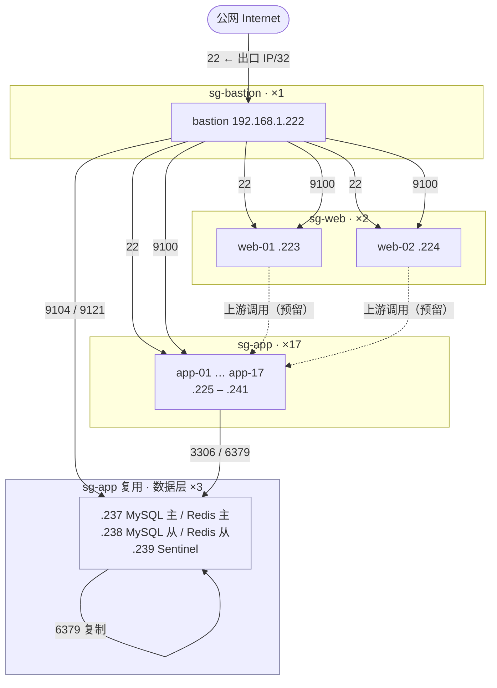

# 架构说明

## 1. 分层模型

20 台 ECS 按职责分为四层，每层对应一个独立安全组。分层的目的不是“画得整齐”，而是让**网络可达性成为职责边界的一部分**：入口层能到应用层，应用层能到数据层，反向不通。

| 层 | 台数 | 内网地址 | 安全组 | 职责 |
|---|---|---|---|---|
| 跳板 / 控制面 | 1 | `.222` | `sg-bastion` | SSH 入口、Ansible 控制节点、Prometheus + Alertmanager + Grafana |
| 入口层 | 2 | `.223`–`.224` | `sg-web` | Nginx，承接上游流量 |
| 应用层 | 14 | `.225`–`.236`、`.240`–`.241` | `sg-app` | 业务进程 |
| 数据层 | 3 | `.237`–`.239` | `sg-app`（复用） | MySQL 主从、Redis 主从 + 3 哨兵 |

**数据层为什么复用了 `sg-app`**：券余额只够维持 20 台，新建 2–3 台数据层实例要多一份日成本。
这是资源约束下的主动取舍：分层边界在实例数上让了一步，换来四层网络规则模型本身是完整的 —— `sg-db` 的规则集已在 2.1 定义好，扩出实例即可挂载。
代价必须说清楚：应用层任何一台被拿下，都能直连 `.237:3306`，横向移动的阻断在当前部署里不成立。这是全项目最明确的一处安全边界让步。

**公网 IP 只在跳板机上。** 其余 19 台没有公网地址，无法被外部直接连接。



---

## 2. 安全组矩阵

### 2.1 入方向

| 安全组 | 协议/端口 | 授权对象 | 类型 | 用途 |
|---|---|---|---|---|
| `sg-bastion` | TCP 22 | `<本机出口 IP>/32` | IPv4 地址段 | 唯一管理入口 |
| `sg-web` | TCP 22 | `sg-bastion` | 安全组 | SSH 管理 |
| `sg-web` | TCP 80 / 443 | `0.0.0.0/0` | IPv4 地址段 | 预留，业务入口 |
| `sg-app` | TCP 22 | `sg-bastion` | 安全组 | SSH 管理 |
| `sg-app` | TCP 9100 | `sg-bastion` | 安全组 | Prometheus 抓取 node_exporter |
| `sg-app` | TCP 9104 / 9121 | `sg-bastion` | 安全组 | 抓取 mysqld_exporter / redis_exporter |
| `sg-db`（预留未用） | TCP 22 | `sg-bastion` | 安全组 | SSH 管理 |
| `sg-db`（预留未用） | TCP 3306 / 6379 | `sg-app` | 安全组 | 上游访问数据库 |

### 2.2 为什么授权对象用「安全组」

阿里云安全组的授权对象有两种：**IPv4 地址段** 和 **安全组**。后者表达的是「来自这个安全组内任何实例的流量」，是一种**身份授权**而非**地址授权**。

本次实践的真实收益：监控从 5 台扩到 20 台时，新增 15 台只需绑定到 `sg-app`，`9100` 那条规则自动覆盖，**控制台零改动**。

如果当初填的是 `192.168.1.222/32`：
- 扩 15 台要再点 15 次控制台
- 未来 Prometheus 迁移到别的机器，所有规则都要改

**代价**是跨层访问会被直接拒绝，而且现象很隐蔽：服务在跑、端口在听、主机防火墙也放行了，但包在安全组层面就被丢了。详见第 5 节。

### 2.3 主机层防火墙（firewalld）

安全组是网络层的第一道闸，firewalld 是主机层的第二道。两者都要放行，缺一不可。

```bash
# 9100 只对内网网段开放，绝不对 0.0.0.0/0
firewall-cmd --permanent --add-rich-rule='rule family="ipv4" source address="192.168.1.0/24" port port="9100" protocol="tcp" accept'
firewall-cmd --reload
```

**为什么 9100 不能对公网开**：`node_exporter` 暴露主机名、内核版本、挂载点、网卡名、进程数、systemd 单元状态，等于把内网拓扑和主机指纹完整公开。它没有认证机制，只能靠网络隔离保护。

---

## 3. 配置管理

### 3.1 Playbook 依赖顺序

```
harden.yml            ← 创建 ops 用户、下发公钥、禁 root
      ↓
init.yml              ← 时区、基础包、sysctl
      ↓
firewall.yml          ← 安装并启用 firewalld
      ↓
firewall-9100.yml     ← 依赖 firewalld 已运行，顺序反了必失败
      ↓
node_exporter.yml     ← 分发二进制 + systemd 托管
      ↓
db-install.yml        ← MySQL / Redis / 哨兵（仅 db、redis_sentinel 组）
      ↓
exporters.yml         ← mysqld_exporter / redis_exporter（仅 db 组）
      ↓
db-replica.yml        ← 建立复制关系（一次性初始化，不在 site.yml 里）
```

`firewall-9100.yml` 用了 `immediate: yes`，它要求 firewalld 守护进程正在运行。所以在 `--check` 模式下会报 `firewall is not currently running`——**check 模式不会真正启动服务**，不是配置错误。

### 3.2 首次接入新机器的顺序

新实例是干净的，没有 `ops` 用户。而 inventory 的全局变量是 `ansible_user=ops`，直接跑任何 playbook 都会 `Permission denied (publickey)`。

```bash
# 1) 扫指纹，消掉交互式 yes/no
for ip in $(seq -f '10.0.0.%g' 13 29); do ssh-keyscan -H "$ip" >> ~/.ssh/known_hosts; done

# 2) 确认 root 可登
ansible <单台> -i inventory -m ping -e ansible_user=root

# 3) 单台先验 harden
ansible-playbook -i inventory playbooks/harden.yml -e ansible_user=root --limit <单台>

# 4) ops 能登后，再全量
ansible-playbook -i inventory playbooks/harden.yml -e ansible_user=root --limit '<新增机器列表>'
```

**必须单台先验**：`harden.yml` 最后会 `restart sshd` 并禁 root。如果配置有误，你只损失一台还能从控制台 Workbench 抢救；15 台一起崩就是 15 台都要手工救。

### 3.3 幂等性

所有 playbook 设计为可反复执行。判断依据：第二次执行 `PLAY RECAP` 里 `changed=0`。

`init.yml` 里的 `dnf install` 因为模块兼容问题改成 `command`，此时需要显式声明：

```yaml
- name: 安装基础包
  command: dnf install -y chrony vim tmux git sysstat
  changed_when: false    # 声明不追踪变更，维持幂等语义
```

---

## 4. 监控架构

### 4.1 组件分布

| 组件 | 位置 | 部署方式 | 端口 |
|---|---|---|---|
| Prometheus | bastion | Docker | `127.0.0.1:9090` |
| Grafana | bastion | Docker | `127.0.0.1:3000` |
| node_exporter | 全部 20 台 | 二进制 + systemd | `*:9100` |

监控中心容器化、被监控节点用二进制：容器只装一台（bastion），20 台业务机不必背容器运行时负担。

### 4.2 访问路径

Prometheus 没有内置认证与多租户，官方建议前置反向代理或限制网络可达。本实践用两层：

1. 容器端口绑定到 `127.0.0.1`，公网网卡上根本没有监听
2. 通过 SSH 本地端口转发访问

```bash
ssh -N ops-prom   # LocalForward 9090 / 3000
# 浏览器打开 http://localhost:9090 与 http://localhost:3000
```

不依赖任何应用层鉴权，也不需要在安全组开 9090/3000。

### 4.3 Grafana 数据源地址

Grafana 与 Prometheus 同在容器网络内，数据源 URL 必须用**容器名**：

```
http://prometheus:9090      ✅
http://localhost:9090       ❌ 指向 Grafana 容器自己
http://127.0.0.1:9090       ❌ 同上
```

### 4.4 单文件挂载的陷阱

Compose 里如果写成：

```yaml
volumes:
  - /opt/prometheus/prometheus.yml:/etc/prometheus/prometheus.yml:ro
```

这是**单文件 bind mount**，绑定的是宿主端的 **inode**。宿主端文件一旦被 `mv` / 重建，inode 变化，容器内仍指向旧 inode——改配置、reload、日志显示成功，但完全没生效。

正确写法是挂目录：

```yaml
volumes:
  - /opt/prometheus:/etc/prometheus:ro
```

目录挂载绑定目录 inode，目录内文件增删改都可见。

**判断方法**（一条命令）：

```bash
stat -c '%i' /opt/prometheus/prometheus.yml
docker exec prometheus stat -c '%i' /etc/prometheus/prometheus.yml
```

两个 inode 不同 → 容器看的是旧文件。

---

## 5. 扩容流程

从 5 台扩到 20 台时，需要改动的地方有且只有四处。漏一处，仓库与环境就不一致。

### 5.1 清单

```ini
[app]
10.0.0.13
...
10.0.0.29     # 新增 15 台
```

### 5.2 新机器初始化

```bash
ansible-playbook -i inventory playbooks/harden.yml -e ansible_user=root --limit "$NEW"
ansible-playbook -i inventory playbooks/init.yml            --limit "$NEW"
ansible-playbook -i inventory playbooks/firewall.yml        --limit "$NEW"
ansible-playbook -i inventory playbooks/firewall-9100.yml   --limit "$NEW"
ansible-playbook -i inventory playbooks/node_exporter.yml   --limit "$NEW"
```

顺序不能乱。`--limit "$NEW"` 只含新增机器，避免碰到已加固的老机器（那些 root 已禁，用 root 跑必红）。

### 5.3 安全组：零改动

新机器绑定到 `sg-app` 即可，`9100` 规则自动覆盖。验证：

```bash
for ip in $(seq -f '192.168.1.%g' 222 241); do
  printf "%s -> " "$ip"
  curl -s -o /dev/null -m 2 -w "%{http_code}\n" "http://$ip:9100/metrics"
done
```

全 `200` 说明规则继承生效。出现 `000` 的那台，检查是否绑到了正确的安全组。

### 5.4 Prometheus 目标

改 `prometheus.yml` 的 targets，然后：

```bash
docker exec prometheus promtool check config /etc/prometheus/prometheus.yml
curl -X POST http://127.0.0.1:9090/-/reload
```

**先校验再 reload**：配置语法错误会让 Prometheus 拒绝加载，而容器是 `restart: unless-stopped`，会陷入反复重启，排查成本远高于此刻校验一次。

### 5.5 文档同步

- 本文档的台数表格与架构图
- `README.md` 的环境规模表与 Mermaid 图

**图与数据不一致，是这个项目最容易被追问的地方。** 说 20 台，图里画 12 台，一被问到就会连带怀疑其他所有细节。

---

## 6. 认证与权限

### 6.1 用户模型

| 用户 | 状态 | 用途 |
|---|---|---|
| `root` | 禁止 SSH 登录 | 仅限控制台 Workbench 应急 |
| `ops` | 唯一 SSH 用户，`wheel` 组，免密 sudo | 日常运维 |

`/etc/sudoers.d/ops` 权限 `0440`，写入时用 `validate: visudo -cf %s` 校验，避免语法错误导致 sudo 全局失效（那种情况只能从控制台救）。

### 6.2 为什么不把 ops 加入 docker 组

`docker` 组成员等价于 root：

```bash
docker run -v /:/host -it alpine chroot /host    # 直接拿到宿主机 root shell
```

这绕开了 `sudo` 的全部日志与限制，等于把加固工作作废。正确做法是 `sudo docker ...`，每次提权在 `/var/log/secure` 留痕：

```
ops : TTY=pts/0 ; PWD=/root ; USER=root ; COMMAND=/bin/docker compose ps
```

### 6.3 登录审计

```bash
grep -c "Failed password" /var/log/secure
```

结果为 `0` 是正常状态：安全组只放行指定来源，且密码登录已禁。

---

## 7. 成本与生命周期

| 项 | 说明 |
|---|---|
| 计费方式 | 按量付费，小时结算 |
| 日成本 | 20 台约 30–50 元（含系统盘与少量公网流量），首日实测峰值约 50 元 |
| 项目结束处置 | **终态快照入库后释放全部实例** |
| 释放后剩余成本 | 0 |

**为什么释放而不是停机**：停机能保留现场，但本项目的信息价值已经全部固化到仓库里 —— playbook、配置、巡检脚本、告警规则、看板 JSON、9 张演练证据、终态快照。
环境随时可用 `bootstrap.yml` + `site.yml` 重建，停机保留的那点"省事"抵不过持续计费。

**释放前必做**：`reports/final-state.txt` 必须已经入库。释放会连同系统盘一起销毁，**没有补救机会** —— 这是整个项目里唯一不可逆的操作，其余所有操作都能靠 Ansible 重放。

---

## 8. 数据层拓扑

### 8.1 角色分配

| 内网地址 | MySQL | Redis | 说明 |
|---|---|---|---|
| `192.168.1.237` | 主（`server_id=1`） | 主 | 复制源、哨兵成员 |
| `192.168.1.238` | 从（`server_id=2`，`read_only=ON`） | 从 | 复制目标、哨兵成员 |
| `192.168.1.239` | — | 仅哨兵 | 不跑 Redis 实例，只投票 |

三个哨兵分布在三台机器上，`quorum=2`。**为什么必须奇数**：网络分区时哨兵要能投出唯一多数，
两台会 1:1 僵持，四台会 2:2 僵持，只有奇数能在少一台时仍然收敛。

### 8.2 MySQL 为什么用 GTID 而不是位点

传统主从要记录 `binlog 文件名 + 偏移量`。主库 binlog 被 `binlog_expire_logs_seconds` 清理后，
位点失效只能重新全量；做主从切换时还要在新主上重新 `SHOW MASTER STATUS` 找位点。

GTID 模式下从库只声明 `SOURCE_AUTO_POSITION=1`，由 MySQL 自己计算该从哪个事务开始追。
代价是每次事务多一个 GTID 分配开销，换来的是**切换时不用算位点**。

### 8.3 从库为什么是 `read_only` 而不是 `super_read_only`

`super_read_only=ON` 连带 `SUPER` 的账号也禁止写，安全性更高，但会带来两个运维摩擦：

1. 从库上创建 exporter 账号会被拒绝
2. 主从切换后，旧从库提权、改参数都要先关掉它

最终取 `read_only=ON`：普通账号写不进去，`root`（带 `SUPER`）仍可运维。
如果环境里根本不允许人在从库上动 SQL，应该开 `super_read_only`——这是取舍，不是标准答案。

### 8.4 账号模型

| 账号 | 来源主机 | 权限 | 用途 |
|---|---|---|---|
| `root` | `localhost` | 全部 | 运维，凭据落在 `/root/.my.cnf`（0600） |
| `repl` | `192.168.1.%` | `REPLICATION SLAVE` | 从库拉 binlog |
| `exporter` | `127.0.0.1` | `PROCESS`、`REPLICATION CLIENT`、`SELECT` | mysqld_exporter |

`exporter` 必须按 **IP** 建而不是 `localhost`：开了 `skip-name-resolve` 之后，
`127.0.0.1` 不会被反解成 `localhost`，按主机名建的账号匹配不上（详见 troubleshooting 案例 14）。

从库不需要手工建这些账号——主库的 `CREATE USER` 会随 binlog 复制过去，这本身就是一次复制验证。

### 8.5 Redis 与哨兵

- 主从：`.238` 配 `replicaof 192.168.1.237 6379`，`masterauth` 与 `requirepass` 同一个密码
- 持久化：`appendonly yes`（AOF）。单机实验环境没开 RDB 快照策略，`RedisRDBFailed` 规则留着但基本不会触发
- 哨兵参数：`down-after-milliseconds 5000`（实验环境偏激进，生产一般 30s 起）、`failover-timeout 60000`
- 哨兵也配了 `sentinel auth-pass`，否则主库有密码时哨兵连不上、永远认为主库挂了

### 8.6 已知缺口

- MySQL 没有自动故障切换（无 MHA / Orchestrator / Group Replication），主库挂掉要人工 `CHANGE REPLICATION SOURCE`
- 哨兵的切换链路**还没有做过演练**，只在 `sentinel get-master-addr-by-name` 层面验证过「3 个哨兵都认同 `.237` 是主」
- Redis 未设 `maxmemory` 与淘汰策略，1.8 GiB 内存的机器上被写满会被内核 OOM 杀掉
