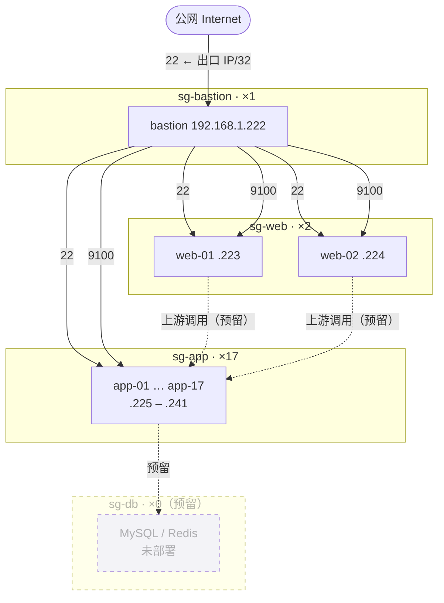

# 架构说明

## 1. 分层模型

20 台 ECS 按职责分为四层，每层对应一个独立安全组。分层的目的不是“画得整齐”，而是让**网络可达性成为职责边界的一部分**：入口层能到应用层，应用层能到数据层，反向不通。

| 层 | 台数 | 内网地址 | 安全组 | 职责 |
|---|---|---|---|---|
| 跳板 / 控制面 | 1 | `.222` | `sg-bastion` | SSH 入口、Ansible 控制节点、Prometheus + Grafana |
| 入口层 | 2 | `.223`–`.224` | `sg-web` | Nginx，承接上游流量 |
| 应用层 | 17 | `.225`–`.241` | `sg-app` | 业务进程 |
| 数据层 | 0 | — | `sg-db` | MySQL 主从 / Redis（**本次未部署**） |

**公网 IP 只在跳板机上。** 其余 19 台没有公网地址，无法被外部直接连接。



---

## 2. 安全组矩阵

### 2.1 入方向

| 安全组 | 协议/端口 | 授权对象 | 类型 | 用途 |
|---|---|---|---|---|
| `sg-bastion` | TCP 22 | `<本机出口 IP>/32` | IPv4 地址段 | 唯一管理入口 |
| `sg-web` | TCP 22 | `sg-bastion` | 安全组 | SSH 管理 |
| `sg-web` | TCP 80 / 443 | `0.0.0.0/0` | IPv4 地址段 | 预留，业务入口 |
| `sg-app` | TCP 22 | `sg-bastion` | 安全组 | SSH 管理 |
| `sg-app` | TCP 9100 | `sg-bastion` | 安全组 | Prometheus 抓取 node_exporter |
| `sg-db`（预留） | TCP 22 | `sg-bastion` | 安全组 | SSH 管理 |
| `sg-db`（预留） | TCP 3306 / 6379 | `sg-app` | 安全组 | 上游访问数据库 |
| `sg-db`（预留） | TCP 9100 / 9104 / 9121 | `sg-bastion` | 安全组 | 指标抓取 |

### 2.2 为什么授权对象用「安全组」

阿里云安全组的授权对象有两种：**IPv4 地址段** 和 **安全组**。后者表达的是「来自这个安全组内任何实例的流量」，是一种**身份授权**而非**地址授权**。

本次实践的真实收益：监控从 5 台扩到 20 台时，新增 15 台只需绑定到 `sg-app`，`9100` 那条规则自动覆盖，**控制台零改动**。

如果当初填的是 `192.168.1.222/32`：
- 扩 15 台要再点 15 次控制台
- 未来 Prometheus 迁移到别的机器，所有规则都要改

**代价**是跨层访问会被直接拒绝，而且现象很隐蔽：服务在跑、端口在听、主机防火墙也放行了，但包在安全组层面就被丢了。详见第 5 节。

### 2.3 主机层防火墙（firewalld）

安全组是网络层的第一道闸，firewalld 是主机层的第二道。两者都要放行，缺一不可。

```bash
# 9100 只对内网网段开放，绝不对 0.0.0.0/0
firewall-cmd --permanent --add-rich-rule='rule family="ipv4" source address="192.168.1.0/24" port port="9100" protocol="tcp" accept'
firewall-cmd --reload
```

**为什么 9100 不能对公网开**：`node_exporter` 暴露主机名、内核版本、挂载点、网卡名、进程数、systemd 单元状态，等于把内网拓扑和主机指纹完整公开。它没有认证机制，只能靠网络隔离保护。

---

## 3. 配置管理

### 3.1 Playbook 依赖顺序

```
harden.yml            ← 创建 ops 用户、下发公钥、禁 root
      ↓
init.yml              ← 时区、基础包、sysctl
      ↓
firewall.yml          ← 安装并启用 firewalld
      ↓
firewall-9100.yml     ← 依赖 firewalld 已运行，顺序反了必失败
      ↓
node_exporter.yml     ← 分发二进制 + systemd 托管
```

`firewall-9100.yml` 用了 `immediate: yes`，它要求 firewalld 守护进程正在运行。所以在 `--check` 模式下会报 `firewall is not currently running`——**check 模式不会真正启动服务**，不是配置错误。

### 3.2 首次接入新机器的顺序

新实例是干净的，没有 `ops` 用户。而 inventory 的全局变量是 `ansible_user=ops`，直接跑任何 playbook 都会 `Permission denied (publickey)`。

```bash
# 1) 扫指纹，消掉交互式 yes/no
for ip in $(seq -f '10.0.0.%g' 13 29); do ssh-keyscan -H "$ip" >> ~/.ssh/known_hosts; done

# 2) 确认 root 可登
ansible <单台> -i inventory -m ping -e ansible_user=root

# 3) 单台先验 harden
ansible-playbook -i inventory playbooks/harden.yml -e ansible_user=root --limit <单台>

# 4) ops 能登后，再全量
ansible-playbook -i inventory playbooks/harden.yml -e ansible_user=root --limit '<新增机器列表>'
```

**必须单台先验**：`harden.yml` 最后会 `restart sshd` 并禁 root。如果配置有误，你只损失一台还能从控制台 Workbench 抢救；15 台一起崩就是 15 台都要手工救。

### 3.3 幂等性

所有 playbook 设计为可反复执行。判断依据：第二次执行 `PLAY RECAP` 里 `changed=0`。

`init.yml` 里的 `dnf install` 因为模块兼容问题改成 `command`，此时需要显式声明：

```yaml
- name: 安装基础包
  command: dnf install -y chrony vim tmux git sysstat
  changed_when: false    # 声明不追踪变更，维持幂等语义
```

---

## 4. 监控架构

### 4.1 组件分布

| 组件 | 位置 | 部署方式 | 端口 |
|---|---|---|---|
| Prometheus | bastion | Docker | `127.0.0.1:9090` |
| Grafana | bastion | Docker | `127.0.0.1:3000` |
| node_exporter | 全部 20 台 | 二进制 + systemd | `*:9100` |

监控中心容器化、被监控节点用二进制：容器只装一台（bastion），20 台业务机不必背容器运行时负担。

### 4.2 访问路径

Prometheus 没有内置认证与多租户，官方建议前置反向代理或限制网络可达。本实践用两层：

1. 容器端口绑定到 `127.0.0.1`，公网网卡上根本没有监听
2. 通过 SSH 本地端口转发访问

```bash
ssh -N ops-prom   # LocalForward 9090 / 3000
# 浏览器打开 http://localhost:9090 与 http://localhost:3000
```

不依赖任何应用层鉴权，也不需要在安全组开 9090/3000。

### 4.3 Grafana 数据源地址

Grafana 与 Prometheus 同在容器网络内，数据源 URL 必须用**容器名**：

```
http://prometheus:9090      ✅
http://localhost:9090       ❌ 指向 Grafana 容器自己
http://127.0.0.1:9090       ❌ 同上
```

### 4.4 单文件挂载的陷阱

Compose 里如果写成：

```yaml
volumes:
  - /opt/prometheus/prometheus.yml:/etc/prometheus/prometheus.yml:ro
```

这是**单文件 bind mount**，绑定的是宿主端的 **inode**。宿主端文件一旦被 `mv` / 重建，inode 变化，容器内仍指向旧 inode——改配置、reload、日志显示成功，但完全没生效。

正确写法是挂目录：

```yaml
volumes:
  - /opt/prometheus:/etc/prometheus:ro
```

目录挂载绑定目录 inode，目录内文件增删改都可见。

**判断方法**（一条命令）：

```bash
stat -c '%i' /opt/prometheus/prometheus.yml
docker exec prometheus stat -c '%i' /etc/prometheus/prometheus.yml
```

两个 inode 不同 → 容器看的是旧文件。

---

## 5. 扩容流程

从 5 台扩到 20 台时，需要改动的地方有且只有四处。漏一处，仓库与环境就不一致。

### 5.1 清单

```ini
[app]
10.0.0.13
...
10.0.0.29     # 新增 15 台
```

### 5.2 新机器初始化

```bash
ansible-playbook -i inventory playbooks/harden.yml -e ansible_user=root --limit "$NEW"
ansible-playbook -i inventory playbooks/init.yml            --limit "$NEW"
ansible-playbook -i inventory playbooks/firewall.yml        --limit "$NEW"
ansible-playbook -i inventory playbooks/firewall-9100.yml   --limit "$NEW"
ansible-playbook -i inventory playbooks/node_exporter.yml   --limit "$NEW"
```

顺序不能乱。`--limit "$NEW"` 只含新增机器，避免碰到已加固的老机器（那些 root 已禁，用 root 跑必红）。

### 5.3 安全组：零改动

新机器绑定到 `sg-app` 即可，`9100` 规则自动覆盖。验证：

```bash
for ip in $(seq -f '192.168.1.%g' 222 241); do
  printf "%s -> " "$ip"
  curl -s -o /dev/null -m 2 -w "%{http_code}\n" "http://$ip:9100/metrics"
done
```

全 `200` 说明规则继承生效。出现 `000` 的那台，检查是否绑到了正确的安全组。

### 5.4 Prometheus 目标

改 `prometheus.yml` 的 targets，然后：

```bash
docker exec prometheus promtool check config /etc/prometheus/prometheus.yml
curl -X POST http://127.0.0.1:9090/-/reload
```

**先校验再 reload**：配置语法错误会让 Prometheus 拒绝加载，而容器是 `restart: unless-stopped`，会陷入反复重启，排查成本远高于此刻校验一次。

### 5.5 文档同步

- 本文档的台数表格与架构图
- `README.md` 的环境规模表与 Mermaid 图

**图与数据不一致，是这个项目最容易被追问的地方。** 说 20 台，图里画 12 台，一被问到就会连带怀疑其他所有细节。

---

## 6. 认证与权限

### 6.1 用户模型

| 用户 | 状态 | 用途 |
|---|---|---|
| `root` | 禁止 SSH 登录 | 仅限控制台 Workbench 应急 |
| `ops` | 唯一 SSH 用户，`wheel` 组，免密 sudo | 日常运维 |

`/etc/sudoers.d/ops` 权限 `0440`，写入时用 `validate: visudo -cf %s` 校验，避免语法错误导致 sudo 全局失效（那种情况只能从控制台救）。

### 6.2 为什么不把 ops 加入 docker 组

`docker` 组成员等价于 root：

```bash
docker run -v /:/host -it alpine chroot /host    # 直接拿到宿主机 root shell
```

这绕开了 `sudo` 的全部日志与限制，等于把加固工作作废。正确做法是 `sudo docker ...`，每次提权在 `/var/log/secure` 留痕：

```
ops : TTY=pts/0 ; PWD=/root ; USER=root ; COMMAND=/bin/docker compose ps
```

### 6.3 登录审计

```bash
grep -c "Failed password" /var/log/secure
```

结果为 `0` 是正常状态：安全组只放行指定来源，且密码登录已禁。

---

## 7. 成本与生命周期

| 项 | 说明 |
|---|---|
| 计费方式 | 按量付费，小时结算 |
| 日成本 | 20 台约 30–50 元（含系统盘与少量公网流量） |
| 实验结束处置 | **停机（节省停机模式）**，不释放 |
| 停机成本 | 仅云盘费用，一天约几毛 |

**为什么不释放**：重建 20 台环境 + 重新跑一遍 Ansible + 重新配安全组，时间成本远超省下的钱。停机保留数据与配置，下次开机即恢复。

**注意**：停机不等于释放，但也**绝不要点错成释放**——实例释放后云盘一并删除，数据不可恢复。
